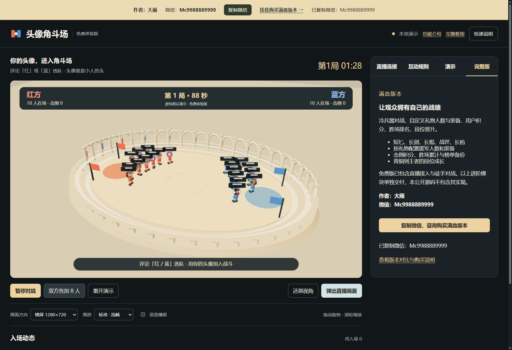

# 头像角斗场 · 免费开源体验版

**作者：大雨｜微信：Mc9988889999｜找我购买满血版本**

观众头像直接成为 3D 小人的头部，评论「红 / 蓝」选择阵营，在角斗场里自动对战。

本仓库是独立可运行的免费体验版，包含直播接入、徒手战斗和固定礼物出兵。**武器、自定义礼物、个人积分、胜场榜、段位模块单独交付，未包含在本仓库。**



## 版本对比

| 功能 | 免费体验版 | 满血版本 |
| --- | --- | --- |
| 直播连接、评论选队、头像小人 | 包含 | 包含 |
| 3D 角斗场、徒手打斗、90 秒回合 | 包含 | 包含 |
| 小心心 3 人、墨镜 10 人 | 固定 | 可配置 |
| 横竖屏小窗、模拟互动、语音、普通触发设置 | 包含 | 包含 |
| 冷兵器、自定义礼物与装备 | 未包含 | 包含 |
| 用户积分、胜场排名、段位、本地榜单备份 | 未包含 | 包含 |

当局阵营击倒与胜负属于免费功能，个人跨局积分属于完整版。联系微信 **Mc9988889999**，备注「头像角斗场完整版」，咨询价格、交付和支持范围。

## Windows 快速开始

1. 安装 [Python 3.12](https://www.python.org/downloads/windows/)（勾选 Add python.exe to PATH 与 Python Launcher）。
2. 安装 [Node.js 22 或 24 LTS](https://nodejs.org/)，以及 [WebView2 Runtime](https://developer.microsoft.com/microsoft-edge/webview2/)。
3. Code → Download ZIP，完整解压到可写目录。不要在压缩包内运行。
4. 双击 `install.bat`：创建独立 `.venv`、安装固定依赖并检查。首次需要联网。
5. 双击 `start.bat`，即可看虚构观众演示。无需 npm install 或前端构建。

也可在 PowerShell 手动执行：

```powershell
py -3.12 -m venv .venv
.\.venv\Scripts\python.exe -m pip install -r requirements-local.txt
.\.venv\Scripts\python.exe -X utf8 launch.py
```

默认本地地址 `http://127.0.0.1:8096/`，占用时尝试 8097、8196、8296；推荐桌面窗口。

如果 Python 3.12 装在自定义位置、未注册到 `py` 或 PATH，可在 PowerShell 执行 `powershell -NoProfile -ExecutionPolicy Bypass -File .\setup.ps1 -PythonExe "C:\你的Python312目录\python.exe"`。安装脚本不会自动下载 Python 或修改系统 PATH。

## 怎么玩

- 评论「红」或「蓝」选队，新观众没选队时按人数平衡分配。
- 默认评论 1 人，小心心 3 人，墨镜 10 人，其他礼物 1 人，全部徒手。数量相乘，2 个墨镜为 20 人。
- 右侧「互动规则」可控制评论、点赞、关注、进场和礼物开关；普通互动可改人数与体型。
- 每局 90 秒，阵营击倒多的一方获胜，同分平局，7 秒后自动下一局。
- 当局参战后锁队，换队指令下局生效；未入场援军跨回合保留。
- 每队最多同时 60 人，总排队上限 2000，超限明确提示。
- 免费版不保存个人积分或段位。礼物映射是本地玩法，不是抖音官方价格或兑换规则。

## 连接直播与采集

1. 填正在直播的数字房间号或 `https://live.douyin.com/房间号`。
2. 「打开直播间窗口」→ 自行登录 → 「开始抓取」。
3. 用真实评论核对昵称、头像、阵营和出兵；连接成功提示本身不能证明所有事件准确。
4. 选横/竖屏 → 「弹出直播画面」。
5. OBS 用窗口采集选择「头像角斗场免费版 · 直播画面」，先录制验证，保持主窗口开启、不最小化。

程序不负责开播和推流。代码包含直播接入能力，**真实账号、真实礼物、OBS 实际采集推流尚未验收**。平台改版、登录状态、网络与头像跨域限制可能影响结果；部分点赞归属来自上游名单轮换。

## 完整教程

- [安装、操作与常见问题](guide.html)（解压后双击可阅读，也可在程序顶部打开）
- [功能介绍](features.html)
- [满血版本与购买说明](purchase.html)
- [测试记录](VALIDATION.md)
- [上传 GitHub 教程](PUBLISHING.md)

## 开发与验证

原生 HTML/CSS/ESM + Three.js，Python + pywebview/WebView2 本地启动，Node.js 数据桥。没有打包构建步骤。

```powershell
node --test --test-reporter=spec *.test.mjs test-bridge-ports.mjs
.\.venv\Scripts\python.exe -X utf8 -m unittest -v test_scene_relay test_public_server
.\.venv\Scripts\python.exe -X utf8 test_desktop.py
```

桌面测试会打开验收窗口，结果放 `.output-test/`；只模拟互动，不操作真实账号。打包用 `python release.py`，只收录 `PUBLIC_FILES.txt` 白名单。

## 许可与来源

免费公开代码采用 [MIT](LICENSE)，允许依许可证使用、修改和再分发。收费交付不撤销免费代码已有授权。完整版独有实现不在本仓库，也不在 Git 历史中。

基于 [志哥AI的 3d-printer-live](https://github.com/rhfbgfgfdg999999/3d-printer-live) 派生，保留原许可证与版权。详见 [NOTICE.md](NOTICE.md) 和 [第三方许可](THIRD_PARTY_NOTICES.md)。不是抖音官方产品，不代表原作者背书或平台授权。
